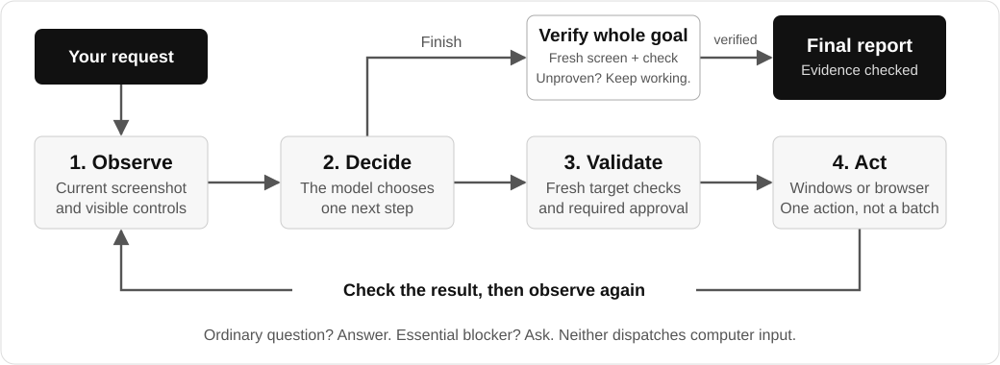

<div align="center">
  
  <h1>Helper</h1>
  <p><strong>Ask a question. Give your Windows PC a task.</strong></p>
  <p>A floating assistant with chat, voice, and observation-driven computer use.</p>
  <p><a href="#get-started">Get started</a> · <a href="#how-it-works">How it works</a> · <a href="docs/USAGE.md">Usage guide</a></p>
</div>

## What is it for?

- **Get an answer or explanation** through the floating orb—no separate chat/action modes.
- **Delegate computer steps:** opening apps or sites, entering text, and navigating visible controls.
- **Keep control:** see the selected action, review consequential-action approvals, and press **Esc** to stop.

Try a small task such as **“Open Notepad and type hello”**, or ask **“How do I change my default browser?”**
Tasks depend on the model, app, and current screen; examples are not success guarantees.

## How it works

Helper does **not** generate a blind sequence of clicks. It observes, chooses **one next step**, validates it,
acts, and checks the result before choosing again.



**The model chooses; Helper controls execution.** The local engine owns Windows/browser input, target validation,
recovery, and cancellation. A separate model check evaluates completion—not just whether a click succeeded.
Ordinary questions return an answer without dispatching computer input; genuine blockers can still require a question.

[Technical architecture and trade-offs →](docs/COMPUTER_USE_ARCHITECTURE.md)

## Get started

**Windows · Python 3.12 · a supported model account**

```powershell
git clone https://github.com/valenciana-nc/Helper-E.git
cd Helper-E
py -3.12 -m venv .venv
.\.venv\Scripts\python.exe -m pip install -r requirements.txt
.\.venv\Scripts\pythonw.exe main.py
```

1. Open **Account** in the dashboard and connect a provider.
2. Click the floating purple orb to type a question or task. Hold it to record voice input.
3. During computer use, the purple glow/banner indicates activity. **Esc** requests cancellation.

| Provider | Connection |
|---|---|
| ChatGPT / Codex | **Sign in with ChatGPT** in Account. |
| Claude / Grok | Add an Anthropic / xAI **API key**, then **Use and restart**. Chat subscriptions are not API access. |
| Gemini / OpenAI-compatible | Configure the provider and credentials in Settings. |

API usage may be billed separately. Voice has its own local-model/OpenAI requirements.
See the [usage guide](docs/USAGE.md) for voice, CLI commands, browser setup, and configuration.

## Know the limits

- **Real access, not a sandbox.** Helper acts with your Windows account and app permissions. Approval checks are heuristics, not a complete security boundary.
- **Esc prevents further input once observed.** An in-flight model/native call may finish or time out before its worker returns.
- **Requests include screen context.** Even ordinary questions currently collect an observation. Screenshots, control text, and recent context are sent to your selected model provider.
- **Follow-ups are in-session.** An unfinished goal can continue while Helper is running; restarting does not restore executable task state.
- **Reliability is still being developed.** Automated tests and synthetic fixtures are not proof that arbitrary Windows tasks will succeed.

## Explore the project

| Resource | What you will find |
|---|---|
| [Usage guide](docs/USAGE.md) | Desktop controls, providers, voice, CLI, browser, settings, and diagnostics. |
| [Architecture](docs/COMPUTER_USE_ARCHITECTURE.md) | Runtime loop, action routes, validation, verification, and recovery. |
| [Testing](docs/TESTING.md) · [Validation](docs/VALIDATION.md) | Reproduction steps, measured checks, and known test caveats. |
| [UI design](docs/UI_DESIGN.md) | Dashboard, purple orb, breathing aura, banner, and agent cursor. |
| [License](LICENSE) | MIT license. |
